<div align="center">



<a href="README.md"></a>
<a href="https://yoanancelly.fr"></a>
<a href="https://yaia-automation.com"></a>

</div>

```console
pyxl@homelab:~$ cat README.md | head -3
# Hi, I'm Yoan.
# InfoSec, automation, and way too many terminal tabs open.
# I build with Claude what I miss, then I share it.
```



## `$ ls ~/agents`

> AI agents, Claude Code, Hermes: tools that put other tools to work.

<table>
<tr>
<td align="center" width="33%" valign="top">
<a href="https://github.com/pyxl-dev/jev-router"></a><br>
<b><a href="https://github.com/pyxl-dev/jev-router">jev-router</a></b><br>
<sub>A small model picks the reasoning effort of every Claude Code message.</sub><br>
<code>TypeScript</code>
</td>
<td align="center" width="33%" valign="top">
<a href="https://github.com/pyxl-dev/remote-login"></a><br>
<b><a href="https://github.com/pyxl-dev/remote-login">remote-login</a></b><br>
<sub>Sign in to your agent's browser from your phone. Your credentials never go through it.</sub><br>
<code>Python</code>
</td>
<td align="center" width="33%" valign="top">
<a href="https://github.com/pyxl-dev/chatgpt-hermes-a2a"></a><br>
<b><a href="https://github.com/pyxl-dev/chatgpt-hermes-a2a">chatgpt-hermes-a2a</a></b><br>
<sub>MCP bridge between ChatGPT and a Hermes agent running on your Mac.</sub><br>
<code>JavaScript</code>
</td>
</tr>
<tr>
<td align="center" width="33%" valign="top">
<a href="https://github.com/pyxl-dev/hermes-office-3d"></a><br>
<b><a href="https://github.com/pyxl-dev/hermes-office-3d">hermes-office-3d</a></b><br>
<sub>An animated office, pixel art or 3D: one character per Hermes session, subagents included.</sub><br>
<code>TypeScript</code>
</td>
<td align="center" width="33%" valign="top">
<a href="https://github.com/pyxl-dev/hermes-desktop-kit"></a><br>
<b><a href="https://github.com/pyxl-dev/hermes-desktop-kit">hermes-desktop-kit</a></b><br>
<sub>Re-appliable plugins and patches for Hermes Desktop that survive updates.</sub><br>
<code>JavaScript</code>
</td>
<td align="center" width="33%" valign="top">
<a href="https://github.com/pyxl-dev/emdash-guard"></a><br>
<b><a href="https://github.com/pyxl-dev/emdash-guard">emdash-guard</a></b><br>
<sub>The em dash, signature of AI text, removed from every reply. No exceptions.</sub><br>
<code>Python</code>
</td>
</tr>
</table>

## `$ ls ~/hacks`

> Hardware and apps do what I want, not what they were planned for.

<table>
<tr>
<td align="center" width="33%" valign="top">
<a href="https://github.com/pyxl-dev/tv-home-webos"></a><br>
<b><a href="https://github.com/pyxl-dev/tv-home-webos">tv-home-webos</a></b><br>
<sub>An Apple TV style home screen for LG TVs, ad-free, with a Rust companion for the TV guide.</sub><br>
<code>webOS</code> <code>Rust</code>
</td>
<td align="center" width="33%" valign="top">
<a href="https://github.com/pyxl-dev/xbox-controller-compatibility"></a><br>
<b><a href="https://github.com/pyxl-dev/xbox-controller-compatibility">xbox-controller-compatibility</a></b><br>
<sub>A wired Xbox controller on Amazon Luna from macOS, with a GIP driver written in WebUSB.</sub><br>
<code>JavaScript</code> <code>WebUSB</code>
</td>
<td align="center" width="33%" valign="top">
<a href="https://github.com/pyxl-dev/dm-insta"></a><br>
<b><a href="https://github.com/pyxl-dev/dm-insta">dm-insta</a></b><br>
<sub>Instagram reduced to DMs. No feed, no Reels, no infinite scroll.</sub><br>
<code>Android</code> <code>Java</code>
</td>
</tr>
</table>

## `$ ls ~/tools`

> CLIs and extensions so I never click the same place twice.

<table>
<tr>
<td align="center" width="33%" valign="top">
<a href="https://github.com/pyxl-dev/simplelogin-cli"></a><br>
<b><a href="https://github.com/pyxl-dev/simplelogin-cli">simplelogin-cli</a></b><br>
<sub>SimpleLogin aliases, mailboxes and domains from the terminal. The API key stays in the Keychain.</sub><br>
<code>Python</code>
</td>
<td align="center" width="33%" valign="top">
<a href="https://github.com/pyxl-dev/o2switch-cli"></a><br>
<b><a href="https://github.com/pyxl-dev/o2switch-cli">o2switch-cli</a></b><br>
<sub>o2switch cPanel DNS, mail, SSL and tokens, with a preview before any write.</sub><br>
<code>Python</code>
</td>
<td align="center" width="33%" valign="top">
<a href="https://github.com/pyxl-dev/cartes-vers-anki"></a><br>
<b><a href="https://github.com/pyxl-dev/cartes-vers-anki">cartes-vers-anki</a></b><br>
<sub>ChatGPT-generated flashcards imported into Anki, 100% local.</sub><br>
<code>Manifest V3</code>
</td>
</tr>
<tr>
<td align="center" width="33%" valign="top">
<a href="https://github.com/pyxl-dev/marktplaats-watch-examples"></a><br>
<b><a href="https://github.com/pyxl-dev/marktplaats-watch-examples">marktplaats-watch-examples</a></b><br>
<sub>New Marktplaats listings and price drops through an Apify Actor (curl, CLI, n8n).</sub><br>
<code>Apify</code> <code>n8n</code>
</td>
<td align="center" width="33%" valign="top">
<a href="https://github.com/pyxl-dev?tab=repositories"></a><br>
<b><a href="https://github.com/pyxl-dev?tab=repositories">ls -a ~/archive</a></b><br>
<sub>Old scripts, forks and experiments.</sub><br>
<code>*.legacy</code>
</td>
<td align="center" width="33%" valign="top">
<a href="https://github.com/pyxl-dev/pyxl-dev"></a><br>
<b><a href="https://github.com/pyxl-dev/pyxl-dev">pyxl-dev/pyxl-dev</a></b><br>
<sub>You are here. This README is a repo like any other.</sub><br>
<code>SVG</code> <code>Actions</code>
</td>
</tr>
</table>

## `$ cat ~/.stack`

<p>


</p>

## `$ ./snake --eat-contributions`

<picture>
  <source media="(prefers-color-scheme: dark)" srcset="https://raw.githubusercontent.com/pyxl-dev/pyxl-dev/output/github-snake-dark.svg">
  <source media="(prefers-color-scheme: light)" srcset="https://raw.githubusercontent.com/pyxl-dev/pyxl-dev/output/github-snake.svg">
  
</picture>

<details>
<summary><code>$ sudo make me-a-sandwich</code></summary>

```console
[sudo] password for pyxl: ********
okay.
```

</details>

<div align="center">
<sub><code>EOF</code> · made with Claude · the snake comes back every night through a GitHub Action</sub>
</div>
