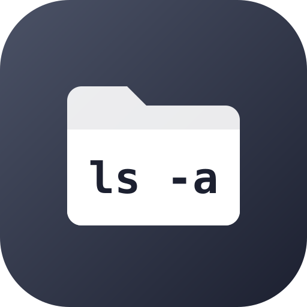
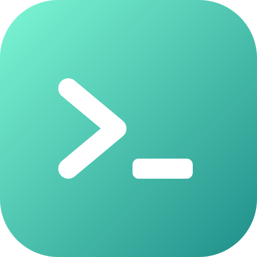

<div align="center">



<a href="README.en.md"></a>
<a href="https://yoanancelly.fr"></a>
<a href="https://yaia-automation.com"></a>

</div>

```console
pyxl@homelab:~$ cat README.md | head -3
# Salut, moi c'est Yoan.
# InfoSec, automatisation, et beaucoup trop d'onglets de terminal ouverts.
# Je build avec Claude ce qui me manque, puis je le partage.
```



## `$ ls ~/agents`

> Agents IA, Claude Code, Hermes : les outils qui font bosser les autres outils.

<table>
<tr>
<td align="center" width="33%" valign="top">
<a href="https://github.com/pyxl-dev/jev-router"></a><br>
<b><a href="https://github.com/pyxl-dev/jev-router">jev-router</a></b><br>
<sub>Un petit modèle choisit l'effort de raisonnement de chaque message Claude Code.</sub><br>
<code>TypeScript</code>
</td>
<td align="center" width="33%" valign="top">
<a href="https://github.com/pyxl-dev/remote-login"></a><br>
<b><a href="https://github.com/pyxl-dev/remote-login">remote-login</a></b><br>
<sub>Connecte-toi au navigateur de ton agent depuis ton téléphone. Tes identifiants ne passent jamais par lui.</sub><br>
<code>Python</code>
</td>
<td align="center" width="33%" valign="top">
<a href="https://github.com/pyxl-dev/chatgpt-hermes-a2a"></a><br>
<b><a href="https://github.com/pyxl-dev/chatgpt-hermes-a2a">chatgpt-hermes-a2a</a></b><br>
<sub>Pont MCP entre ChatGPT et un agent Hermes qui tourne sur ton Mac.</sub><br>
<code>JavaScript</code>
</td>
</tr>
<tr>
<td align="center" width="33%" valign="top">
<a href="https://github.com/pyxl-dev/hermes-office-3d"></a><br>
<b><a href="https://github.com/pyxl-dev/hermes-office-3d">hermes-office-3d</a></b><br>
<sub>Un bureau animé, en pixel art ou en 3D : un personnage par session Hermes, sous-agents compris.</sub><br>
<code>TypeScript</code>
</td>
<td align="center" width="33%" valign="top">
<a href="https://github.com/pyxl-dev/hermes-desktop-kit"></a><br>
<b><a href="https://github.com/pyxl-dev/hermes-desktop-kit">hermes-desktop-kit</a></b><br>
<sub>Plugins et patches ré-appliquables pour Hermes Desktop, qui survivent aux mises à jour.</sub><br>
<code>JavaScript</code>
</td>
<td align="center" width="33%" valign="top">
<a href="https://github.com/pyxl-dev/emdash-guard"></a><br>
<b><a href="https://github.com/pyxl-dev/emdash-guard">emdash-guard</a></b><br>
<sub>Le tiret cadratin, signature des textes d'IA, supprimé de chaque réponse. Sans exception.</sub><br>
<code>Python</code>
</td>
</tr>
<tr>
<td align="center" width="33%" valign="top">
<a href="https://github.com/pyxl-dev/waiting-on-me"></a><br>
<b><a href="https://github.com/pyxl-dev/waiting-on-me">waiting-on-me</a></b><br>
<sub>Les sessions Claude Code qui attendent ta réponse, rangées à part dans la sidebar.</sub><br>
<code>TypeScript</code>
</td>
<td align="center" width="33%" valign="top">
<a href="https://github.com/pyxl-dev/remote-session-titles"></a><br>
<b><a href="https://github.com/pyxl-dev/remote-session-titles">remote-session-titles</a></b><br>
<sub>De vrais titres pour les sessions Claude Code lancées depuis ton téléphone.</sub><br>
<code>TypeScript</code>
</td>
</tr>
</table>

## `$ ls ~/hacks`

> Le matériel et les apps font ce que je veux, pas ce qu'on a prévu pour eux.

<table>
<tr>
<td align="center" width="33%" valign="top">
<a href="https://github.com/pyxl-dev/tv-home-webos"></a><br>
<b><a href="https://github.com/pyxl-dev/tv-home-webos">tv-home-webos</a></b><br>
<sub>Un accueil façon Apple TV pour télé LG, sans pubs, avec un compagnon Rust pour le guide TNT.</sub><br>
<code>webOS</code> <code>Rust</code>
</td>
<td align="center" width="33%" valign="top">
<a href="https://github.com/pyxl-dev/xbox-controller-compatibility"></a><br>
<b><a href="https://github.com/pyxl-dev/xbox-controller-compatibility">xbox-controller-compatibility</a></b><br>
<sub>Une manette Xbox filaire sur Amazon Luna depuis macOS, avec un pilote GIP écrit en WebUSB.</sub><br>
<code>JavaScript</code> <code>WebUSB</code>
</td>
<td align="center" width="33%" valign="top">
<a href="https://github.com/pyxl-dev/dm-insta"></a><br>
<b><a href="https://github.com/pyxl-dev/dm-insta">dm-insta</a></b><br>
<sub>Instagram réduit à la messagerie. Pas de fil, pas de Reels, pas de scroll infini.</sub><br>
<code>Android</code> <code>Java</code>
</td>
</tr>
<tr>
<td align="center" width="33%" valign="top">
<a href="https://github.com/pyxl-dev/lettre-pere-noel"></a><br>
<b><a href="https://github.com/pyxl-dev/lettre-pere-noel">lettre-pere-noel</a></b><br>
<sub>Deux wishlists de Noël échangées comme des lettres au Père Noël, scellées jusqu'au jour J.</sub><br>
<code>Cloudflare Workers</code> <code>JavaScript</code>
</td>
</tr>
</table>

## `$ ls ~/tools`

> Des CLI et des extensions pour ne plus jamais cliquer deux fois au même endroit.

<table>
<tr>
<td align="center" width="33%" valign="top">
<a href="https://github.com/pyxl-dev/simplelogin-cli"></a><br>
<b><a href="https://github.com/pyxl-dev/simplelogin-cli">simplelogin-cli</a></b><br>
<sub>Alias, mailboxes et domaines SimpleLogin depuis le terminal. La clé API reste dans le Trousseau.</sub><br>
<code>Python</code>
</td>
<td align="center" width="33%" valign="top">
<a href="https://github.com/pyxl-dev/o2switch-cli"></a><br>
<b><a href="https://github.com/pyxl-dev/o2switch-cli">o2switch-cli</a></b><br>
<sub>DNS, mails, SSL et tokens cPanel o2switch, avec un aperçu avant toute écriture.</sub><br>
<code>Python</code>
</td>
<td align="center" width="33%" valign="top">
<a href="https://github.com/pyxl-dev/cartes-vers-anki"></a><br>
<b><a href="https://github.com/pyxl-dev/cartes-vers-anki">cartes-vers-anki</a></b><br>
<sub>Les cartes générées par ChatGPT importées dans Anki, 100 % en local.</sub><br>
<code>Manifest V3</code>
</td>
</tr>
<tr>
<td align="center" width="33%" valign="top">
<a href="https://github.com/pyxl-dev/marktplaats-watch-examples"></a><br>
<b><a href="https://github.com/pyxl-dev/marktplaats-watch-examples">marktplaats-watch-examples</a></b><br>
<sub>Nouvelles annonces et baisses de prix Marktplaats, via un Actor Apify (curl, CLI, n8n).</sub><br>
<code>Apify</code> <code>n8n</code>
</td>
<td align="center" width="33%" valign="top">
<a href="https://github.com/pyxl-dev?tab=repositories"></a><br>
<b><a href="https://github.com/pyxl-dev?tab=repositories">ls -a ~/archive</a></b><br>
<sub>Les vieux scripts, les forks et les expériences.</sub><br>
<code>*.legacy</code>
</td>
<td align="center" width="33%" valign="top">
<a href="https://github.com/pyxl-dev/pyxl-dev"></a><br>
<b><a href="https://github.com/pyxl-dev/pyxl-dev">pyxl-dev/pyxl-dev</a></b><br>
<sub>Vous êtes ici. Ce README est un dépôt comme un autre.</sub><br>
<code>SVG</code> <code>Actions</code>
</td>
</tr>
</table>

## `$ cat ~/.stack`

<p>


</p>

## `$ ./snake --eat-contributions`

<picture>
  <source media="(prefers-color-scheme: dark)" srcset="https://raw.githubusercontent.com/pyxl-dev/pyxl-dev/output/github-snake-dark.svg">
  <source media="(prefers-color-scheme: light)" srcset="https://raw.githubusercontent.com/pyxl-dev/pyxl-dev/output/github-snake.svg">
  
</picture>

<details>
<summary><code>$ sudo make me-a-sandwich</code></summary>

```console
[sudo] password for pyxl: ********
okay.
```

</details>
